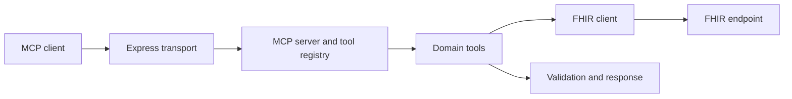

<div align="center">
  

  <p>
    
    
    
    <a href="LICENSE"></a>
  </p>
</div>

## 🤰 What it is

Doula is a TypeScript Model Context Protocol server that connects MCP clients to FHIR-backed maternal-health context and a set of domain tools. It exposes structured tools through an HTTP server rather than asking a language model to invent its own data access.

## 🔌 Request path



## 🧰 Stack

| Area | Tools |
|---|---|
| Runtime | Node.js 20+, TypeScript, ESM |
| Protocol and transport | `@modelcontextprotocol/sdk`, Express, Streamable HTTP |
| Clinical interface | FHIR client via `@smile-cdr/fhirts` |
| Validation and logging | Zod, Pino |
| Tests | Vitest |

## 🚀 Run locally

```bash
git clone https://github.com/ChristopherJoshy/Doula.git
cd doula
npm ci
cp .env.example .env
npm run dev
```

In PowerShell, use `Copy-Item .env.example .env`. Configure `PORT`, `LOG_LEVEL`, and the FHIR connection/auth context expected by the server. The development server uses `tsx`; production output is built with TypeScript.

```bash
npm test
npm run typecheck
npm run build
```

## 🗂️ Layout

```text
src/server/   MCP transport and lifecycle
src/fhir/     FHIR client and context
src/tools/    tool implementations and registry
src/core/     errors, logging and request context
data/         local fixtures and reference data
tests/        Vitest suite
```

## 📄 License

MIT. See [`LICENSE`](LICENSE).

## ⚠️ Clinical-data boundary

This is a prototype integration, not clinical advice or a production EHR. Use synthetic fixtures for development. Any real deployment needs authorization, privacy review, clinical validation, and access-control testing appropriate to its FHIR environment.